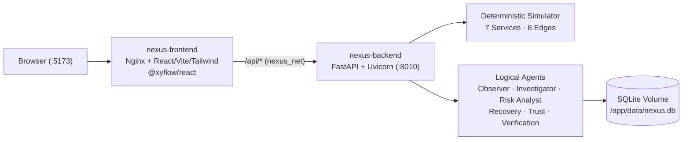

# NEXUS — Autonomous Infrastructure Resilience & Trust Engine

**Tagline:** *Predict. Investigate. Recover. Verify.*  
**Competition:** BUILD 2036 — Digital Infrastructure (DPI · Cybersecurity · Cloud · Trust)

NEXUS is a local, reproducible, AI-enabled infrastructure resilience platform that simulates cascading service failures, correlates monitoring alerts into unified incidents, performs evidence-grounded root-cause investigation, enforces declarative Trust Agent recovery policies with human approval boundaries, executes controlled simulated mitigations, verifies multi-tick SLO recovery, and records every consequential step in an immutable SQLite audit trail.

---

## 1. Problem Statement & Solution

Modern digital payment and public infrastructure systems are deeply interdependent: a single database bottleneck can trigger API timeouts, payment degradation, and message queue backlogs within seconds—flooding operators with disconnected alerts while creating pressure to execute risky fixes.

**NEXUS** addresses this with a governed, end-to-end resilience lifecycle:

**Detect → Investigate → Plan → Evaluate Policy → Approve → Simulate Recovery → Verify → Resolve**

### Key Capabilities
- **Deterministic Cascading Failure Simulator:** 7-service checkout & payments topology (`api-gateway`, `auth-service`, `checkout-api`, `payment-service`, `order-queue`, `worker-fulfillment`, `postgres-primary`) with 8 directed edges, mathematical fault-pressure curves, topological latency/error propagation, and queue conservation-of-flow dynamics.
- **Interactive Service Dependency Graph:** Live `@xyflow/react` visualization highlighting the root-cause origin, cascading blast radius, animated failing edges, healthy isolated services, and a click-to-inspect Service Inspector.
- **Evidence-Grounded Incident Intelligence:** Logical `Observer` → `Investigator` → `Risk Analyst` pipeline producing traceable `EVID-*` references, causal service role classification, a 4-criterion explainable confidence rubric, explicit limitations, and a 0–100 blast-radius risk score. Works 100% deterministically without an API key, with an optional read-only structured LLM adapter that validates evidence IDs and falls back automatically.
- **Policy-Gated Simulated Recovery & Multi-Tick Verification:** `RecoveryAgent` proposes actions exclusively from a static allowlist (`expand_db_connection_pool`, `enable_circuit_breaker`, `scale_queue_consumers`). `TrustAgent` independently enforces declarative rules (`POL-001`–`POL-008`), requiring explicit human approval for high-risk or database-tier actions. `VerificationAgent` requires 2 consecutive healthy ticks across all affected services and `order-queue < 250` before resolving the incident.
- **Immutable Audit Timeline:** Append-only SQLite ledger persisting 20 distinct lifecycle action types with incident, category, and actor filtering, chronological sorting, and raw JSON payload inspection.

---

## 2. System Architecture & Technology Stack

Full detailed architecture diagrams are available in [docs/08-architecture-diagram.md](docs/08-architecture-diagram.md).



| Layer | Technology |
| :--- | :--- |
| **Frontend** | React 18, TypeScript, Vite 6, Tailwind CSS, `@xyflow/react`, Lucide Icons, Nginx 1.27 |
| **Backend** | Python 3.11 (Docker) / 3.10+ (local), FastAPI, Uvicorn, Pydantic v2, SQLAlchemy 2.0, SQLite |
| **AI Boundary** | Deterministic-first engine + optional read-only `httpx` JSON adapter with evidence-ID grounding & fallback |
| **Packaging** | Docker & Docker Compose (`nexus_net` bridge network + `nexus_sqlite_data` persistent volume) |

---

## 3. Prerequisites

- **Recommended (One-Command Deployment):** Docker Engine `24+` and Docker Compose `v2+` (`docker compose version`).
- **Optional (Local Dev without Docker):** Python `3.10+` and Node.js `20+`.

---

## 4. Fresh-Start Deployment (Docker Compose)

1. Clone the repository and enter the project directory:
   ```bash
   git clone <repository-url>
   cd nexus
   ```
2. *(Optional)* Copy `.env.example` to `.env` to customize ports or optional LLM settings (safe defaults work out of the box with no `.env` required):
   ```bash
   cp .env.example .env
   ```
3. Build and start NEXUS:
   ```bash
   docker compose up --build
   ```
   *(Or run detached with health wait: `docker compose up -d --build --wait`)*
4. Verify both services are healthy:
   ```bash
   docker compose ps
   ```
5. Stop containers cleanly (preserving the persistent SQLite volume `nexus_sqlite_data`):
   ```bash
   docker compose down
   ```

### Access URLs
- **NEXUS Web Console:** [http://localhost:5173](http://localhost:5173)
- **Backend API Base:** [http://localhost:8010/api/v1/health](http://localhost:8010/api/v1/health)
- **Interactive API Docs (Swagger UI):** [http://localhost:8010/docs](http://localhost:8010/docs)

---

## 5. Environment Configuration

See [.env.example](.env.example). Never commit `.env` or real API keys.

| Variable | Default | Purpose |
| :--- | :--- | :--- |
| `NEXUS_FRONTEND_PORT` | `5173` | Host port mapped to Nginx frontend (`80`) |
| `NEXUS_BACKEND_PORT` | `8010` | Host port mapped to FastAPI backend (`8010`) |
| `NEXUS_AI_MODE` | `deterministic` | `deterministic` (zero external APIs), `auto`, or `llm` |
| `NEXUS_SIM_TICK_INTERVAL_SECONDS` | `2.0` | Background simulation tick interval |
| `NEXUS_DATABASE_URL` | `sqlite:///./data/nexus.db` | Local SQLite path (`sqlite:////app/data/nexus.db` in Docker) |
| `NEXUS_LLM_API_KEY` | *(empty)* | Optional OpenAI-compatible API key (unused in `deterministic` mode) |
| `NEXUS_LLM_BASE_URL` | `https://api.openai.com/v1` | Optional LLM endpoint base URL |
| `NEXUS_LLM_MODEL` | `gpt-4o-mini` | Optional LLM model identifier |
| `VITE_API_BASE_URL` | `/api/v1` | Frontend API base path (proxied by Nginx in Docker) |

---

## 6. End-to-End Demonstration Walkthrough

For a timed presenter script, see [docs/09-demo-script.md](docs/09-demo-script.md).

1. Open [http://localhost:5173](http://localhost:5173) and confirm `API: ONLINE` and `SQLite: READY`.
2. Open **Topology**, click **Inject `db_latency_cascade`**, and click **+1 Tick** six times (or **Start** for ~12s, then **Stop**).
3. Observe `postgres-primary` highlighted as `ROOT CAUSE · CRITICAL`, 5 impacted downstream services, `order-queue` accumulating backlog (`1316` msgs), 7 animated failing edges, and `auth-service` remaining `HEALTHY` and isolated.
4. Open **Incidents**, select `INC-0001`, and click **Run Investigation** to inspect the root-cause hypothesis, `EVID-*` evidence, 4-criterion confidence rubric, blast-radius risk score, and causal service roles.
5. In **Policy-Gated Recovery Operations**, click **Propose Recovery Plan** (`PLAN-0001`: `expand_db_connection_pool`) and review the Trust Agent's `REQUIRE_HUMAN_APPROVAL` verdict (`POL-006`, `POL-007`).
6. Enter an optional justification comment, click **Approve Plan**, and click **Execute Simulated Recovery**.
7. Click **Advance +2 Ticks & Verify** until `Verification` reaches **`VERIFIED`** (`2/2` consecutive healthy ticks) and `INC-0001` transitions to **`RESOLVED`**.
8. Open **Audit Trail** to inspect the full chronological SQLite audit history (`INCIDENT_DETECTED` → `INCIDENT_RESOLVED`), filter by incident/category/actor, and expand raw JSON payloads.

### Application Screenshots (Captured from Live Docker Deployment)
- [Topology Cascade & Service Inspector](submission-assets/screenshots/01-infrastructure-topology-cascade.png)
- [Incident Dossier & Evidence-Grounded Investigation](submission-assets/screenshots/02-incident-dossier-investigation.png)
- [Recovery Plan & Trust Agent Policy Gate](submission-assets/screenshots/03-recovery-plan-policy-decision.png)
- [Human Approval & Simulated Execution](submission-assets/screenshots/04-human-approval-and-execution.png)
- [Multi-Tick Verified Recovery & Resolution](submission-assets/screenshots/05-verified-recovery-and-resolution.png)
- [Persisted Incident Audit Timeline](submission-assets/screenshots/06-incident-audit-timeline.png)

---

## 7. Testing & Verification

### Backend Regression Suite (25 tests)
```bash
cd backend
python3 -m venv .venv
.venv/bin/pip install -r requirements.txt
.venv/bin/pytest -v
```

### Frontend TypeScript & Production Build
```bash
cd frontend
npm ci
npm run build
```

### Container Persistence Verification
After completing an incident walkthrough under Docker Compose, run `docker compose restart` and refresh **Audit Trail** at [http://localhost:5173](http://localhost:5173) — all SQLite incident and audit records persist via the `nexus_sqlite_data` volume.

---

## 8. Troubleshooting

- **Port `5173` or `8010` already in use:** Set `NEXUS_FRONTEND_PORT` or `NEXUS_BACKEND_PORT` in `.env` before running `docker compose up --build`.
- **WSL2 + Windows development:** Run Python, Node, and Docker commands natively inside WSL Ubuntu (`/home/yemisi/projects/nexus`) rather than over the Windows `\\wsl.localhost\...` UNC share to avoid slow 9P imports and UNC path issues.
- **Resetting demo state cleanly:** Use **Reset Baseline** in the UI (`POST /api/v1/simulation/reset`) to restore healthy metrics while preserving the append-only audit ledger.

---

## 9. Explicit Limitations & Simulation Disclosure

- **100% Local Simulation:** All services, metrics, alerts, and recovery actions are modeled locally inside NEXUS. NEXUS does **not** process real payments, connect to live cloud infrastructure, or execute real OS/shell/Kubernetes commands.
- **Demo Operator Identity:** The human approval endpoints accept an `actor` field (default `sre-operator`) to demonstrate governed authorization boundaries; this is not production SSO/RBAC authentication.
- **On-Demand Verification Evaluation:** Verification evaluates post-execution telemetry when queried (`GET /api/v1/remediations/{plan_id}/verification` or via the UI verification button) and requires 2 consecutive healthy ticks within a 10-tick window.
- **Single-Tenant Local SQLite:** SQLite persistence is intended for local, zero-cost reproducibility rather than multi-region production high availability.
