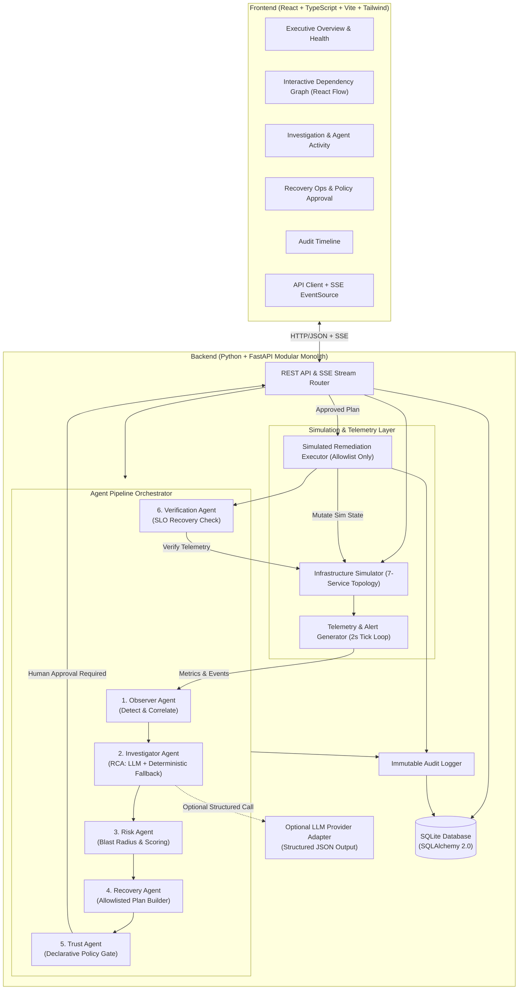
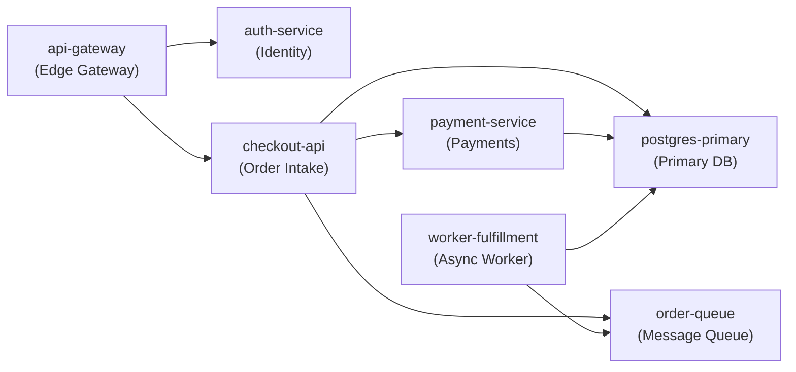
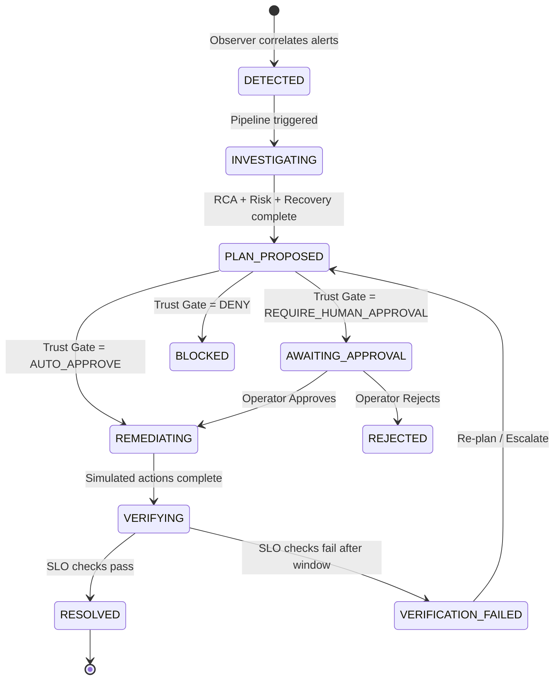

# NEXUS — System Architecture

**Project:** NEXUS — Autonomous Infrastructure Resilience & Trust Engine  
**Version:** 1.0 (MVP)

---

## 1. Architectural Principles

1. **Modular Monolith Backend:** A single FastAPI service hosts the simulator, event store, lightweight agent orchestrator, policy engine, and REST/SSE APIs. This eliminates distributed plumbing overhead while keeping clear internal module boundaries.
2. **Lightweight Logical Agents:** The 6 agent roles (`Observer`, `Investigator`, `Risk`, `Recovery`, `Trust`, `Verification`) are implemented as stateless, typed Python classes with strict Pydantic I/O contracts—not 6 separate LLM microservices. Only `Investigator` (and optionally `Recovery` rationale) calls an LLM when configured; all other agents are deterministic, fast, and auditable.
3. **Simulation-First Safety Boundary:** All infrastructure state lives inside a sandboxed `SimulationEngine`. Remediation actions are pure state transitions on simulated service parameters—never OS or network commands.
4. **Event-Driven UI via SSE:** Backend pushes live telemetry ticks, incident updates, agent step completions, and audit entries over Server-Sent Events (`GET /api/v1/stream`), with full REST endpoints for state hydration and control actions.

---

## 2. High-Level System Architecture

---

## 3. Simulated Infrastructure Topology

The default simulated environment represents a realistic checkout & payments microservice cluster:

### Cascading Failure Propagation Model
Rather than hardcoding static fake alerts, the `SimulationEngine` computes service metrics at each tick (every 2 seconds) using a **directed propagation model**:
- Each service has intrinsic health parameters (`base_latency_ms`, `error_rate`, `cpu_pct`, `connection_pool_pct`, `queue_depth`).
- Fault injections modify intrinsic parameters on a root node (e.g., `postgres-primary` pool saturation -> high DB latency).
- Downstream/caller services calculate effective latency and error rates as a function of their own state **plus** weighted latency/failure contributions from their upstream dependencies.
- When `postgres-primary` latency exceeds 1,200ms:
  1. `payment-service` and `checkout-api` latency & timeout error rates rise automatically.
  2. `api-gateway` reflects elevated 5xx rates from `checkout-api`.
  3. `worker-fulfillment` throughput drops, causing `order-queue` depth to grow linearly every tick.
- When simulated remediation actions execute (e.g., expanding DB connection pool, enabling payment circuit breaker, scaling fulfillment workers), the propagation equations naturally converge back to healthy baselines—making recovery verification genuinely telemetry-driven.

---

## 4. Incident Lifecycle & State Machine

---

## 5. AI & Deterministic Dual-Mode Design

To guarantee evidence-based output and 100% hackathon demo reliability:

- **Mode Selection:** Controlled by environment variable (`NEXUS_AI_MODE=auto|llm|deterministic`) and toggleable in the UI for demonstration purposes.
  - `auto` (default): Uses LLM if `LLM_API_KEY` is configured; automatically falls back to `deterministic` on missing key, timeout (>8s), or schema validation failure.
- **Evidence Grounding Contract:** Before calling the LLM, the `Investigator` constructs an immutable `EvidenceBundle` containing exact `event_id`s, service metric deltas, and graph paths. The LLM must return a Pydantic-validated JSON object referencing only IDs present in `EvidenceBundle`. Any ungrounded citation is stripped or rejected, triggering fallback.
- **Deterministic Engine:** Uses topological root-cause traversal (finding the deepest unhealthy dependency whose anomaly timestamp precedes downstream symptoms) + metric signature matching to produce identical structured `InvestigationResult` objects with clear confidence scores and limitations.

---

## 6. Trust, Policy & Security Architecture

| Layer | Control Mechanism |
| :--- | :--- |
| **Action Catalog** | Static Python registry of safe simulated actions (`expand_db_connection_pool`, `enable_circuit_breaker`, `scale_queue_consumers`, `restart_service_pool`, `throttle_gateway_traffic`). No arbitrary strings or shell commands. |
| **Policy Engine (Trust Agent)** | Declarative rules evaluated deterministically against `Incident.severity`, `RiskAssessment.risk_score`, and `RemediationStep.target_tier`. Returns `AUTO_APPROVE`, `REQUIRE_HUMAN_APPROVAL`, or `DENY` with matched rule IDs. |
| **Execution Gate** | `ActionExecutor` refuses to execute any plan whose `status != APPROVED` (either via `AUTO_APPROVE` or recorded human approval). |
| **Audit Immutability** | `audit_logs` table is append-only (no update/delete APIs). Every state transition, AI hypothesis, policy check, and operator click writes a timestamped, actor-attributed record. |

---

## 7. Deployment & Runtime Architecture

- **Local Development:**
  - Backend: `uvicorn app.main:app --reload --port 8000`
  - Frontend: `npm run dev` (Vite on port `5173`, proxying `/api` to `http://localhost:8000`)
- **Docker Compose (`docker-compose.yml`):**
  - `nexus-backend`: Python 3.11-slim container exposing port `8000`, mounting a local SQLite volume (`./data:/app/data`).
  - `nexus-frontend`: Multi-stage Node 20 build -> Nginx container exposing port `3000`, reverse-proxying `/api/` (including SSE with buffering disabled) to `nexus-backend:8000`.
- **Zero Cloud Dependencies:** Runs completely offline in `deterministic` mode; requires only outbound HTTPS to an LLM endpoint when `LLM_API_KEY` is supplied.

