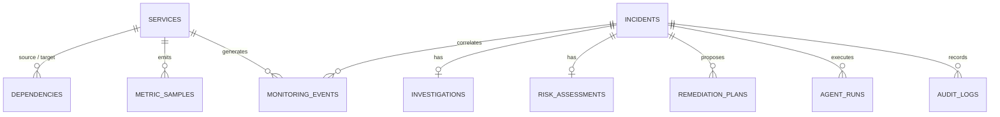

# NEXUS — Data Models

**Persistence:** SQLite via SQLAlchemy 2.0 ORM (`backend/data/nexus.db`)  
**Validation:** Pydantic v2 schemas (`backend/app/schemas/`)  
**JSON Columns:** Structured nested payloads (evidence lists, blast radius graphs, action parameters) are stored as validated JSON columns in SQLite to keep schema migrations minimal for the hackathon MVP.

---

## 1. Entity-Relationship Overview



---

## 2. Core Domain Models (Pydantic & SQLite)

### 2.1 `ServiceNode` (`services` table)
Represents a simulated infrastructure component.
| Field | Type | Description |
| :--- | :--- | :--- |
| `id` | `str` (PK) | Unique slug (e.g., `postgres-primary`, `payment-service`) |
| `name` | `str` | Display name |
| `tier` | `Enum` | `edge` \| `application` \| `messaging` \| `worker` \| `database` |
| `status` | `Enum` | `healthy` \| `degraded` \| `critical` |
| `criticality` | `int` (1–5) | Business criticality weight used in risk & resilience scoring |
| `baseline_latency_ms` | `float` | Normal p99 latency |
| `slo_latency_ms` | `float` | Latency threshold for alerts & recovery verification |
| `slo_error_rate` | `float` | Error rate threshold (0.0–1.0) |

### 2.2 `DependencyEdge` (`dependencies` table)
Directed call/data dependency (`source_id` depends on `target_id`).
| Field | Type | Description |
| :--- | :--- | :--- |
| `id` | `str` (PK) | Edge identifier |
| `source_id` | `str` (FK -> `services.id`) | Caller service |
| `target_id` | `str` (FK -> `services.id`) | Upstream dependency |
| `protocol` | `str` | e.g., `http`, `grpc`, `amqp`, `tcp/postgres` |
| `impact_weight` | `float` (0.0–1.0) | Fault propagation coupling factor |

### 2.3 `MetricSample` (`metric_samples` table)
Point-in-time telemetry snapshot (pruned to rolling window of last ~500 samples per service).
| Field | Type | Description |
| :--- | :--- | :--- |
| `id` | `int` (PK, autoincrement) | Sample ID |
| `service_id` | `str` (FK) | Target service |
| `timestamp` | `datetime` (UTC) | Sample time |
| `latency_ms` | `float` | Current p99 latency |
| `error_rate` | `float` | Fraction of failed requests (0.0–1.0) |
| `cpu_pct` | `float` | Simulated CPU utilization (0–100) |
| `saturation_pct` | `float` | Connection pool / thread pool saturation (0–100) |
| `queue_depth` | `int` | Pending messages (for queue/worker services) |

### 2.4 `MonitoringEvent` (`monitoring_events` table)
Threshold violation or anomaly signal emitted by the simulator.
| Field | Type | Description |
| :--- | :--- | :--- |
| `id` | `str` (PK, UUID) | Event ID (cited by AI evidence) |
| `service_id` | `str` (FK) | Originating service |
| `incident_id` | `str \| None` (FK) | Correlated incident once grouped |
| `event_type` | `str` | e.g., `LATENCY_SPIKE`, `HTTP_5XX_SURGE`, `POOL_SATURATION`, `QUEUE_BACKLOG` |
| `severity` | `Enum` | `LOW` \| `MEDIUM` \| `HIGH` \| `CRITICAL` |
| `metric_name` | `str` | Triggering metric |
| `metric_value` | `float` | Observed value |
| `threshold_value` | `float` | Breached threshold |
| `message` | `str` | Human-readable alert message |
| `timestamp` | `datetime` (UTC) | Detection timestamp |

---

## 3. Incident, AI Investigation & Risk Models

### 3.1 `Incident` (`incidents` table)
| Field | Type | Description |
| :--- | :--- | :--- |
| `id` | `str` (PK, e.g., `INC-1001`) | Human-readable incident ID |
| `title` | `str` | Concise incident summary |
| `scenario_id` | `str \| None` | Triggering scenario if injected |
| `status` | `Enum` | `DETECTED` \| `INVESTIGATING` \| `PLAN_PROPOSED` \| `AWAITING_APPROVAL` \| `REMEDIATING` \| `VERIFYING` \| `RESOLVED` \| `VERIFICATION_FAILED` \| `REJECTED` \| `BLOCKED` |
| `severity` | `Enum` | `LOW` \| `MEDIUM` \| `HIGH` \| `CRITICAL` |
| `probable_root_cause_service` | `str \| None` | Service ID identified by Investigator |
| `resilience_impact` | `float` | Points deducted from global resilience score |
| `created_at` | `datetime` (UTC) | First detection time |
| `updated_at` | `datetime` (UTC) | Last state change |
| `resolved_at` | `datetime \| None` | Verified recovery time |

### 3.2 `InvestigationResult` (`investigations` table)
| Field | Type | Description |
| :--- | :--- | :--- |
| `id` | `str` (PK) | Investigation ID |
| `incident_id` | `str` (FK, unique) | Linked incident |
| `inference_mode` | `Enum` | `LLM` \| `DETERMINISTIC` |
| `model_name` | `str \| None` | LLM model identifier or `"nexus-deterministic-v1"` |
| `root_cause_service` | `str` | Probable root cause service ID |
| `root_cause_summary` | `str` | Structured explanation of probable cause |
| `propagation_chain` | `list[str]` (JSON) | Ordered list of service IDs from root to edge symptom |
| `evidence` | `list[EvidenceItem]` (JSON) | Cited facts (`event_id`, `service_id`, `observation`, `timestamp`) |
| `confidence` | `float` (0.0–1.0) | Calibrated confidence score |
| `limitations` | `list[str]` (JSON) | Explicit gaps/uncertainties (e.g., no SQL query plan visibility) |
| `created_at` | `datetime` (UTC) | Completion time |

### 3.3 `RiskAssessment` (`risk_assessments` table)
| Field | Type | Description |
| :--- | :--- | :--- |
| `id` | `str` (PK) | Risk assessment ID |
| `incident_id` | `str` (FK, unique) | Linked incident |
| `risk_score` | `int` (0–100) | Composite risk score |
| `severity` | `Enum` | `LOW` \| `MEDIUM` \| `HIGH` \| `CRITICAL` |
| `blast_radius_services` | `list[str]` (JSON) | All impacted service IDs |
| `customer_facing_impact` | `bool` | Whether edge/checkout/payment services are affected |
| `business_impact_summary` | `str` | Plain-English impact statement |
| `factors` | `dict[str, float]` (JSON) | Breakdown (criticality, spread, error_rate, queue_backlog) |

---

## 4. Remediation, Policy & Audit Models

### 4.1 `RemediationPlan` (`remediation_plans` table)
| Field | Type | Description |
| :--- | :--- | :--- |
| `id` | `str` (PK) | Plan ID |
| `incident_id` | `str` (FK) | Linked incident |
| `status` | `Enum` | `PROPOSED` \| `AWAITING_APPROVAL` \| `APPROVED` \| `EXECUTING` \| `COMPLETED` \| `REJECTED` \| `DENIED` \| `FAILED` |
| `summary` | `str` | High-level recovery strategy |
| `steps` | `list[RemediationStep]` (JSON) | Ordered allowlisted actions (see below) |
| `policy_verdict` | `Enum` | `AUTO_APPROVE` \| `REQUIRE_HUMAN_APPROVAL` \| `DENY` |
| `policy_reasons` | `list[str]` (JSON) | Matched policy rule IDs and explanations |
| `approved_by` | `str \| None` | Operator ID or `"AUTO_POLICY"` |
| `approval_comment` | `str \| None` | Operator note |
| `verification_result` | `VerificationResult \| None` (JSON) | Post-execution SLO check outcomes |
| `created_at` | `datetime` (UTC) | Plan creation time |
| `executed_at` | `datetime \| None` | Execution start time |

**`RemediationStep` (embedded JSON schema):**
```python
class RemediationStep(BaseModel):
    step_order: int
    action_id: Literal[
        "expand_db_connection_pool",
        "enable_circuit_breaker",
        "scale_queue_consumers",
        "restart_service_pool",
        "throttle_gateway_traffic",
    ]
    target_service: str
    parameters: dict[str, int | float | str | bool]
    rationale: str
    expected_impact: str
    status: Literal["PENDING", "EXECUTED", "SKIPPED", "FAILED"] = "PENDING"
```

### 4.2 `AgentRun` (`agent_runs` table)
| Field | Type | Description |
| :--- | :--- | :--- |
| `id` | `str` (PK) | Run ID |
| `incident_id` | `str` (FK) | Linked incident |
| `agent_name` | `Enum` | `Observer` \| `Investigator` \| `Risk` \| `Recovery` \| `Trust` \| `Verification` |
| `status` | `Enum` | `RUNNING` \| `COMPLETED` \| `FAILED` |
| `inference_mode` | `Enum` | `DETERMINISTIC` \| `LLM` |
| `duration_ms` | `int` | Execution duration |
| `summary` | `str` | Concise 1-line summary for UI activity feed |
| `output_snapshot` | `dict` (JSON) | Structured output payload |
| `created_at` | `datetime` (UTC) | Timestamp |

### 4.3 `AuditLogEntry` (`audit_logs` table — Append-Only)
| Field | Type | Description |
| :--- | :--- | :--- |
| `id` | `str` (PK, UUID) | Unique audit entry ID |
| `incident_id` | `str \| None` (FK) | Related incident (if applicable) |
| `actor_type` | `Enum` | `SYSTEM` \| `AGENT` \| `POLICY` \| `HUMAN` |
| `actor_name` | `str` | e.g., `Investigator`, `TrustAgent`, `sre-operator`, `Simulator` |
| `action` | `str` | e.g., `FAULT_INJECTED`, `INCIDENT_CORRELATED`, `RCA_COMPLETED`, `POLICY_EVALUATED`, `PLAN_APPROVED`, `ACTION_EXECUTED`, `RECOVERY_VERIFIED` |
| `details` | `dict` (JSON) | Immutable structured context |
| `timestamp` | `datetime` (UTC) | UTC timestamp |

