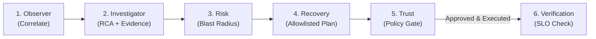

# NEXUS — Agent Contracts

**Design Philosophy:** NEXUS implements 6 specialized **logical agents** orchestrated sequentially per incident lifecycle. Each agent has a strict Pydantic input/output contract, deterministic execution guarantees, and zero direct shell or unconstrained write access. Only the **Investigator Agent** optionally invokes an LLM (with strict evidence grounding and automatic deterministic fallback).

---

## 1. Pipeline Overview

Every agent invocation is wrapped by `AgentOrchestrator`, which:
1. Validates input/output Pydantic models.
2. Records an `AgentRun` trace for the UI Activity Feed.
3. Appends an immutable `AuditLogEntry`.
4. Broadcasts an `agent_step` SSE event.

---

## 2. Individual Agent Contracts

### 2.1 Observer Agent (`observer.py`)
- **Role:** Detect anomalous telemetry bursts and correlate related monitoring events into a single unified incident.
- **Mode:** Deterministic (Graph + Time-Window Correlation).
- **Input (`ObserverInput`):**
  - `uncorrelated_events: list[MonitoringEvent]` (events within the last 60s without an `incident_id`)
  - `topology: TopologyGraph`
  - `active_incidents: list[Incident]`
- **Output (`ObserverOutput`):**
  - `action: Literal["NOOP", "CREATE_INCIDENT", "ATTACH_TO_INCIDENT"]`
  - `incident_id: str | None`
  - `correlated_event_ids: list[str]`
  - `suggested_title: str`
  - `correlation_rationale: str` (e.g., *"Correlated 6 alerts across 5 connected services within 12s window"*)
- **Constraints:** Must not create duplicate incidents for events connected in the dependency graph within the active correlation window.

---

### 2.2 Investigator Agent (`investigator.py`)
- **Role:** Determine the probable root cause, trace the cascading propagation chain, cite concrete evidence, quantify confidence, and state analytical limitations.
- **Mode:** **LLM (Structured JSON) with Deterministic Fallback**.
- **Input (`InvestigatorInput`):**
  - `incident: Incident`
  - `correlated_events: list[MonitoringEvent]`
  - `telemetry_snapshots: dict[str, list[MetricSample]]` (before & during incident)
  - `topology: TopologyGraph`
  - `ai_mode: Literal["auto", "llm", "deterministic"]`
- **Output (`InvestigationResult`):**
  - `inference_mode: Literal["LLM", "DETERMINISTIC"]`
  - `root_cause_service: str` (must exist in `topology`)
  - `root_cause_summary: str`
  - `propagation_chain: list[str]` (ordered root -> leaf symptom)
  - `evidence: list[EvidenceItem]` (every `event_id` must exist in `correlated_events`)
  - `confidence: float` (`0.0` to `1.0`)
  - `limitations: list[str]` (minimum 1 explicit limitation required)
- **Safety & Grounding Rules:**
  - LLM prompt receives *only* serialized `EvidenceBundle` and must return valid JSON matching `InvestigationResult`.
  - Post-processor verifies every cited `event_id` and `service_id` exists in the input bundle. If validation fails or LLM times out (>8s), seamlessly falls back to the deterministic engine and logs the fallback reason in `limitations`.

---

### 2.3 Risk Agent (`risk.py`)
- **Role:** Compute blast radius across the dependency graph, determine severity, and produce a transparent composite risk score (0–100).
- **Mode:** Deterministic (Weighted Graph Traversal).
- **Input (`RiskInput`):**
  - `incident: Incident`
  - `investigation: InvestigationResult`
  - `topology: TopologyGraph`
  - `current_metrics: dict[str, MetricSample]`
- **Output (`RiskAssessment`):**
  - `risk_score: int` (0–100)
  - `severity: Literal["LOW", "MEDIUM", "HIGH", "CRITICAL"]`
  - `blast_radius_services: list[str]`
  - `customer_facing_impact: bool`
  - `business_impact_summary: str`
  - `factors: dict[str, float]` (explicit formula breakdown: `service_criticality`, `blast_radius_ratio`, `error_severity`, `queue_pressure`)
- **Constraints:** Scoring formula must be fully deterministic and explainable via `factors`.

---

### 2.4 Recovery Agent (`recovery.py`)
- **Role:** Propose a safe, ordered, simulated remediation plan tailored to the root cause and affected services.
- **Mode:** Deterministic Playbook Matcher (optionally enriched with LLM rationale text, never LLM-invented actions).
- **Input (`RecoveryInput`):**
  - `incident: Incident`
  - `investigation: InvestigationResult`
  - `risk: RiskAssessment`
  - `allowed_actions: list[ActionDefinition]` (static catalog)
- **Output (`RemediationPlanDraft`):**
  - `summary: str`
  - `steps: list[RemediationStep]`
  - `rollback_criteria: str`
- **Hard Security Constraint:** Every `step.action_id` **must** belong to `ACTION_CATALOG` and pass parameter bounds validation (e.g., `pool_multiplier` between `1.2` and `3.0`). Freeform commands are impossible by schema design.

---

### 2.5 Trust Agent (`trust.py`)
- **Role:** Act as the immutable Safety & Policy Gate between recommendation and execution.
- **Mode:** Deterministic Rule Engine (never delegated to an LLM).
- **Input (`TrustInput`):**
  - `incident: Incident`
  - `investigation: InvestigationResult`
  - `risk: RiskAssessment`
  - `plan: RemediationPlanDraft`
  - `policies: list[PolicyRule]`
- **Output (`TrustVerdict`):**
  - `decision: Literal["AUTO_APPROVE", "REQUIRE_HUMAN_APPROVAL", "DENY"]`
  - `matched_policy_ids: list[str]`
  - `reasons: list[str]`
- **Default MVP Policy Rules:**
  1. `POL-001 (DENY)`: Reject any plan containing an unrecognized `action_id` or out-of-bounds parameter.
  2. `POL-002 (REQUIRE_HUMAN_APPROVAL)`: Any plan targeting a `database` tier service (e.g., `postgres-primary`).
  3. `POL-003 (REQUIRE_HUMAN_APPROVAL)`: Any incident with `severity == CRITICAL` or `risk_score >= 70`.
  4. `POL-004 (REQUIRE_HUMAN_APPROVAL)`: Any investigation with `confidence < 0.75`.
  5. `POL-005 (AUTO_APPROVE)`: Low/medium risk non-database actions with high confidence (`>= 0.85`).

---

### 2.6 Verification Agent (`verification.py`)
- **Role:** Verify that simulated remediation actually restored service health within SLOs before closing the incident.
- **Mode:** Deterministic Telemetry Evaluator.
- **Input (`VerificationInput`):**
  - `incident: Incident`
  - `plan: RemediationPlan`
  - `affected_services: list[str]`
  - `verification_window_seconds: int` (default `8s` = 4 simulator ticks for snappy demo)
- **Output (`VerificationResult`):**
  - `passed: bool`
  - `checks: list[SloCheck]` (per-service `latency_ms < slo_latency_ms`, `error_rate < slo_error_rate`, `queue_depth` trend `draining` or `< 100`)
  - `post_recovery_resilience_score: float`
  - `summary: str`
  - `verified_at: datetime`
- **Outcome Transition:**
  - If `passed == True`: Incident -> `RESOLVED`, Audit -> `RECOVERY_VERIFIED`.
  - If `passed == False`: Incident -> `VERIFICATION_FAILED`, Audit -> `VERIFICATION_FAILED`, alerting operator for escalation.

