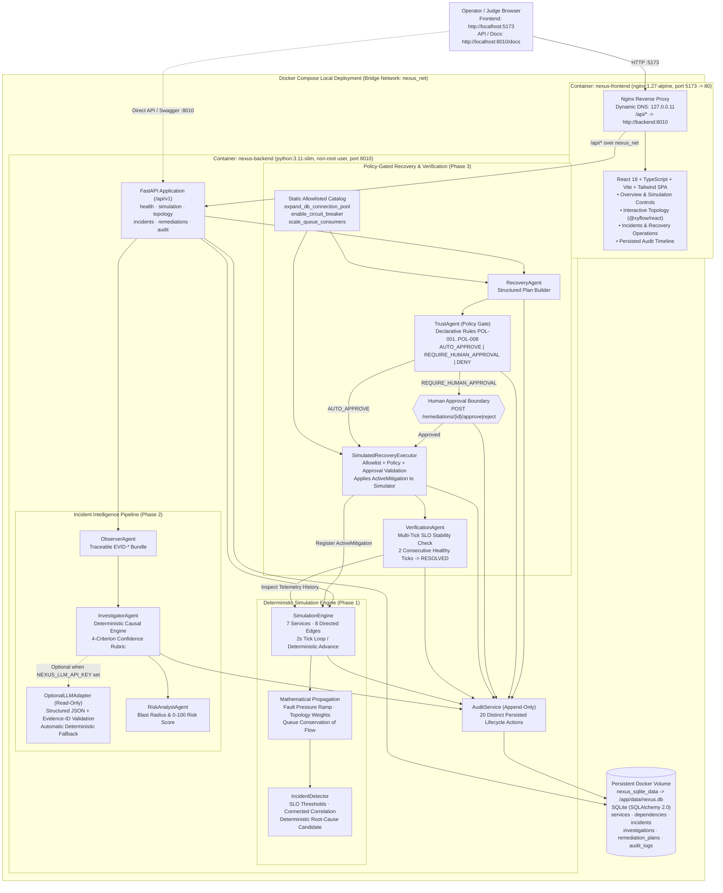
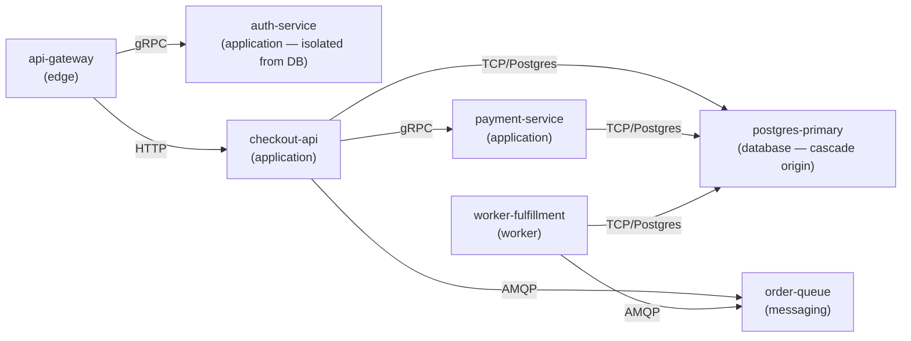

# NEXUS — Actual-Implementation System Architecture

**Project:** NEXUS — Autonomous Infrastructure Resilience & Trust Engine  
**Tagline:** *Predict. Investigate. Recover. Verify.*  
**Baseline:** Commit `061e47a` (Phases 0 – 4C Complete)

---

## 1. End-to-End Runtime & Container Architecture

The diagram below reflects the exact implemented architecture running under `docker compose up --build`, with zero hypothetical components or external cloud dependencies.

---

## 2. Simulated Service Dependency Topology (7 Services · 8 Directed Edges)

---

## 3. Trust & Safety Boundaries

1. **Zero Real Infrastructure Execution:** `SimulatedRecoveryExecutor` only registers bounded `ActiveMitigation` parameters inside `SimulationEngine`. No shell commands, scripts, Kubernetes APIs, or cloud calls exist.
2. **Static Action Allowlist:** Only the 3 actions in `backend/app/recovery/catalog.py` can be approved or executed; unknown actions or out-of-bounds parameters are denied by `TrustAgent` (`POL-001`–`POL-003`).
3. **Separation of Recommendation and Execution:** `RecoveryAgent` can only create plans; `TrustAgent` independently enforces `POL-001`–`POL-008`, and `DENY` decisions cannot be overridden by human approval.
4. **Authoritative Multi-Tick Verification:** Incidents transition to `RESOLVED` only after `VerificationAgent` observes 2 consecutive healthy ticks across all affected services and `order-queue < 250`.
5. **Immutable Auditability:** All 20 lifecycle actions are persisted in SQLite `audit_logs` inside the persistent `nexus_sqlite_data` Docker volume.
